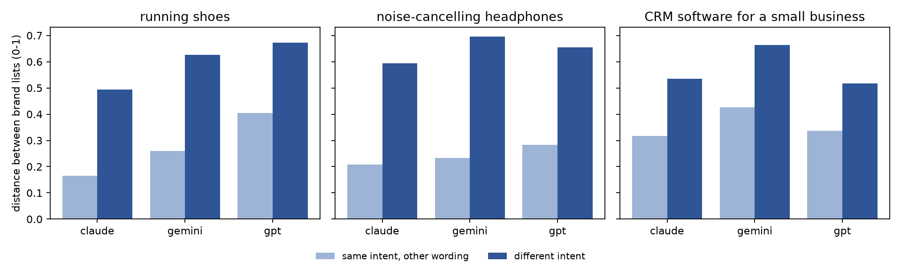

# Do AI Assistants Follow Stated Shopper Intent?

**Evidence from 1,800 brand recommendations by Claude, GPT and Gemini** · Jass Di Domenico ([jass.didomenico@gmail.com](mailto:jass.didomenico@gmail.com)) · November 2026

📄 **[Read the 2-page paper (PDF)](docs/paper.pdf)** · [Plain-language memo (PDF)](docs/memo.pdf) · [Results summary](data/full/results/summary.md) · [All answers (CSV)](data/full/answers_with_brands.csv)

---

When a shopper tells an AI assistant what they care about (a low price, premium quality, sustainability, being a first-time buyer), does the assistant change which brands it recommends? Or does the brand list mostly move with how the question happens to be worded?

This repository contains the full study: prompts, all 1,800 raw answers, the coded brands, the analysis and the quality checks.

## Key findings

1. **Stated intent moves the brand list 1.5–3.0× more than rewording does**, in all 9 model × category cells (permutation test, p < 0.001).
2. **Intent works through the tail.** Category leaders (Sony and Bose, HubSpot and Zoho, Brooks and ASICS) persist across intents. Intent swaps in specialists: "sustainable" brings in Fairphone (100% of headphone answers) and Veja (94% of shoe answers); "premium" lifts Salesforce from 38% to 92% of CRM answers.
3. **Repeats are stable but rarely identical.** Repeating a prompt gives overlapping brand sets (Jaccard 0.71–0.80), but exactly identical lists in only 7.5–20.6% of pairs.
4. **Models differ in concentration.** The top 3 brands get 56–86% of GPT's recommendations, against 34–67% for Claude.



*Distance between the brand profiles of two prompts (0 = identical, 1 = no overlap). Light bars: same intent, different wording. Dark bars: different intent.*

## Design

| Factor | Levels |
|---|---|
| Category | running shoes, noise-cancelling headphones, CRM software for a small business |
| Intent | neutral, budget, premium, sustainable, novice |
| Wording | 4 phrasings per intent, identical across categories |
| Model | Claude (`claude-opus-5-5`), GPT (`gpt-6.1-sol`), Gemini (`gemini-3.8-flash`) |
| Repeats | 10 per prompt |

3 × 5 × 4 = 60 prompts, × 3 models × 10 repeats = **1,800 answers**, collected 1–2 November 2026. Every model is called through its API with default settings, no system prompt, no web search and no memory. The full prompt set is in [`study/design.py`](study/design.py).

**Coding.** Claude extracts each answer's brands, in order, with a stance (recommended, mentioned, warned against) and a verbatim quote, using a fixed JSON schema. Code rejects any quote that does not appear in the answer. Coding accuracy was measured on a random sample of 100 answers in two ways, reported separately: an audit by four independent AI reviewers (100/100 correct) and a human hand-check (29/29 correct).

**Change after data collection (coding only).** The first audit (2026-11-03) found 85/100 correct: GPT often answers with a shortlist table and then names a favourite, and the coder marked the other table rows as "mentioned". The coding rule was clarified (every offered option is "recommended"; shops and review sites are always "mentioned"), all 1,800 answers were re-coded, and a fresh random sample was drawn for the audit. The answers themselves were not collected again. The first coding is kept in [`data/full/coding-v1/`](data/full/coding-v1/).

## Measures

1. **Intent vs. wording (main result).** For each model and category, each prompt gets a brand visibility vector: the share of its 10 answers that recommend each brand. The distance between two prompts is the weighted Jaccard (Ruzicka) distance between their vectors. The test compares the average distance between prompts with *different* intents to the average between *different wordings of the same intent*. A permutation test (2,000 random relabelings of intent) gives the p-value.
2. **Stability.** The Jaccard overlap of brand sets when the same prompt is repeated, and the share of exactly identical lists.
3. **Concentration.** The share of all recommendations that go to the top 3 brands, per intent.
4. **Model agreement.** The overlap of each pair of models' top-5 brands, per category and intent.

## Predictions (written before data collection)

_Written 2026-11-01, before any real data was collected. Not formally registered._

1. Intent effect: stated intent changes the recommended brands more than rewording does, for all three models; the effect is strongest for sustainable and budget and weakest for novice, which mostly returns the neutral list.
2. Stability: repeating the same prompt returns an identical brand list in under 5% of pairs, but the top 3 brands stay largely the same (mean overlap above 0.5).
3. Concentration: in the neutral and novice conditions, the top 3 brands take at least half of all recommendations; budget and sustainable spread recommendations across more brands.
4. Model agreement: the three models agree most on running shoes and headphones and least on CRM software, where the market is more fragmented.

**Outcome:** 1 supported; 2 partly (identical lists 7.5–20.6%, above the predicted 5%; overlap above 0.5 supported); 3 partly (true for novice in every cell, not for Claude's neutral shoes and CRM); 4 not yet tested by category.

## Repository structure

```
docs/
  paper.pdf                  2-page paper (extended-abstract format)
  memo.pdf                   plain-language 2-page summary
data/
  full/
    answers.jsonl            all 1,800 raw answers with model version, tokens and timestamp
    codings.jsonl            coded brands per answer (stance + verbatim quote)
    answers_with_brands.csv  one row per answer: question, answer, recommended / mentioned / warned-against brands
    handcheck.csv            the 100-answer validation sample (AI audit + human marks)
    results/                 summary.md and all charts
    coding-v1/               the first coding, before the rule fix
  pilot/                     the 36-answer pilot (never enters the results)
study/                       the pipeline: design, model calls, extraction, quality gates, analysis
```

### Data fields

`answers.jsonl`: `id` (provider|model|prompt|repeat), `provider`, `model`, `served_model`, `prompt_id`, `category`, `intent`, `phrasing`, `rep`, `prompt`, `answer`, `status`, `flag`, `in_tokens`, `out_tokens`, `attempts`, `at` (UTC).

`codings.jsonl`: `id`, the design fields, `gives_recommendation`, `brands` (list of `brand`, `key`, `stance`, `quote`, `position`), `check_failed`, `attempts`, token counts, `at`.

Brand-name variants (e.g. Soundcore → Anker, Freshsales → Freshworks) are merged at analysis time using [`study/aliases.json`](study/aliases.json). The CSV already applies these merges.

## Reproduce

```bash
python3 -m venv .venv && .venv/bin/pip install -r requirements.txt
.venv/bin/python -m study analyze            # re-runs the analysis on the included data (no API keys needed)
```

To collect new data, add API keys and run the full pipeline:

```bash
cp env.template .env                         # then add your API keys
.venv/bin/python -m study pilot              # 36 answers; writes data/pilot/pilot_report.md
.venv/bin/python -m study approve            # in your own terminal: type APPROVE
.venv/bin/python -m study run                # full run; locked until approved; resumable
.venv/bin/python -m study handcheck          # draw the validation sample
.venv/bin/python -m study review             # hand-check answers one by one
.venv/bin/python -m study analyze            # data/full/results/summary.md + charts
```

To test the whole pipeline with fake answers and no API calls, use `--mock` and point `STUDY_OUT` at a scratch folder:

```bash
STUDY_OUT=/tmp/study-mock .venv/bin/python -m study pilot --mock --mock-fail-rate 0.1
```

### Quality controls

- **Answer gate.** An answer is accepted only if it is non-empty, not cut off, and came from the requested model. Technical failures are retried up to 3 times. Refusals and short answers are kept as data, never retried, so retries cannot bias the results.
- **Extraction gate.** Every brand must come with a quote that appears word for word in the answer, and the "gives a recommendation" flag must match the brand list. Failed codings are retried with the failing check (max 3), then sent to the hand-check and excluded from the analysis.
- **Stop rule.** If more than 2% of one model's answers fail permanently, that model is stopped, because a setting is probably wrong.
- **Approval lock.** The full run needs a typed approval after the pilot. The approval is tied to a fingerprint of the prompts, models and settings, so any change after approval locks the run again. The pilot gate also requires the predictions above to be filled in.
- **Results gate.** `summary.md` is marked READY only when at most 2% of planned answers are missing, at least 20 answers were hand-checked by a human with at least 90% correct, and the AI audit (if present) is also at least 90%. An AI audit alone never makes the results READY.
- **Brand-name fixes.** Merges confirmed in the hand-check are saved to `study/aliases.json` and applied on every analysis.

Pilot data is kept in `data/pilot/` and never enters the results, because settings may change after the pilot.

## Limitations

- API models without web search or memory do not behave exactly like the consumer apps.
- Three categories and English prompts only; the results may not generalize.
- The three models sit at different price tiers, and a model update can change the results. The model IDs and dates are recorded with every answer.
- Brand coding is automated; its accuracy is measured on a validation sample, not assumed.

## Citation

```
Di Domenico, J. (2026). Do AI assistants follow stated shopper intent? Evidence from 1,800 brand
recommendations by Claude, GPT and Gemini. Working paper. https://github.com/JasDidom/ai-assistant-shopper-intent
```

## License

Code: [MIT](LICENSE). Data, paper and figures: [CC BY 4.0](https://creativecommons.org/licenses/by/4.0/). The AI answers in `data/` were generated by the respective model providers and are shared for research purposes.
